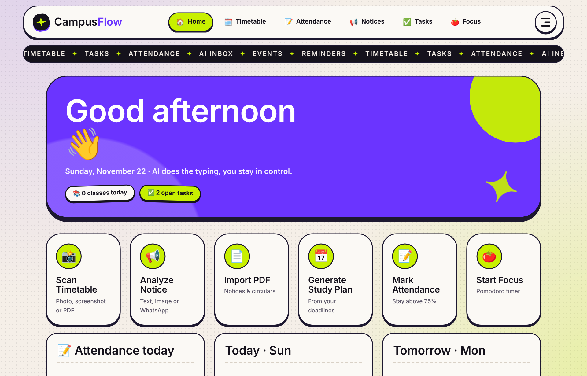
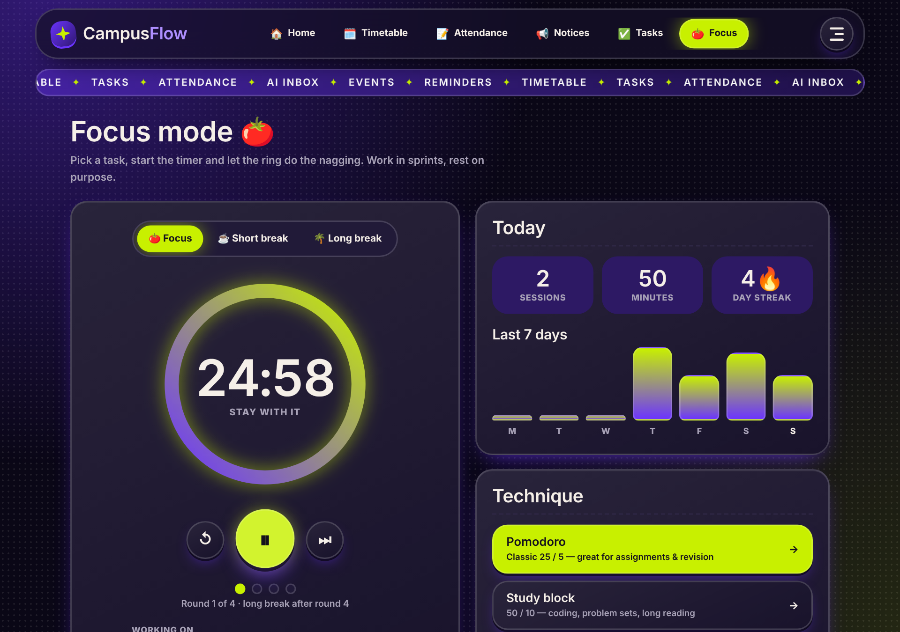
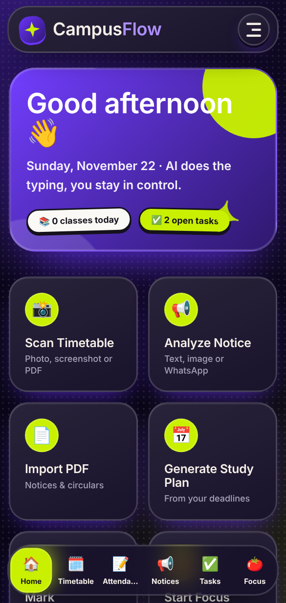

<div align="center">

# ✦ CampusFlow

**Your whole college life, organised by AI. You stay in control.**

Scan a timetable, paste a notice, track attendance, plan your study time and stay focused with a built-in Pomodoro timer, all in one single-page app.




</div>

---

## ✨ Features

| | Feature | What it does |
| --- | --- | --- |
| 🗓️ | **Timetable scanner** | Upload a photo, screenshot or PDF of your timetable. AI extracts the classes and you review them before anything is saved. |
| 📢 | **Notice intelligence** | Paste text, an image or a WhatsApp message. AI labels it *Urgent / Important / Informational / Irrelevant* and pulls out dates and actions. |
| 📝 | **Attendance tracker** | Mark attendance per class and see where you stand against the 75% line. |
| ✅ | **Tasks and deadlines** | Assignments with subject, category, priority and due dates. |
| 🍅 | **Focus mode (Pomodoro)** | A progress-ring timer with Pomodoro 25/5, 50/10, 90/20 and 15/3 presets and custom lengths. Link sessions to tasks, get a chime, and see streaks and a 7-day chart. A floating timer follows you across pages. |
| 🎯 | **Study planner** | Builds a plan automatically from your open tasks, exams and deadlines. |
| 📆 | **Calendar** | Month view of classes, deadlines and events. |
| 🤖 | **AI assistant** | Answers only from your *confirmed* CampusFlow data. |
| 🛡️ | **AI Trust Center** | See everything AI extracted, where it came from and how confident it was. AI-created actions can be undone. |
| 🎨 | **Themes** | Light and dark mode, plus six colour pairs that you can pick or let auto-cycle. |

> **Human in the loop:** AI never writes to your data silently. Extracted items are shown for review first, and you can undo AI-created actions.

## 🖼️ Screenshots

<table>
  <tr>
    <td width="62%"></td>
    <td width="38%"></td>
  </tr>
  <tr>
    <td align="center"><sub>Focus mode with the Pomodoro ring (dark)</sub></td>
    <td align="center"><sub>Mobile layout with the bottom dock (dark)</sub></td>
  </tr>
</table>

## 🧱 Tech stack

- **Frontend:** a single `index.html` using vanilla JavaScript and CSS. There is no build step and no framework.
- **Database and auth:** [Supabase](https://supabase.com) Postgres with Row Level Security and Supabase Auth. Sessions start as anonymous, and users can optionally save the account with an email and password.
- **AI:** [Google Gemini](https://aistudio.google.com) with an optional [Groq](https://console.groq.com) backup, called from a Vercel serverless function so server keys never reach the browser. See [How AI works](#-how-ai-works-and-why-it-wont-run-dry).
- **Hosting:** [Vercel](https://vercel.com), which serves the static page and the `/api` functions.

## 📁 Project structure

```
CampusFlow/
├── index.html          # The whole app: UI, styles and logic
├── api/
│   ├── ai.js           # Authenticated AI proxy: key rotation, fallback, limits, cache
│   └── config.js       # Serves the public Supabase URL and anon key
├── supabase/
│   └── schema.sql      # user_data table and Row Level Security policy
├── docs/screenshots/   # Images used in this README
└── .env.example        # Environment variables template
```

## 🚀 Getting started

### 1. Set up Supabase

1. Create a project at [supabase.com](https://supabase.com).
2. Open the **SQL Editor** and run [`supabase/schema.sql`](./supabase/schema.sql).
3. Go to **Project Settings → API** and copy the **Project URL** and the **anon / publishable key**.
4. Go to **Authentication** and enable **Anonymous Sign-Ins**. The app creates a session automatically, so students never see a sign-up wall.

### 2. Get a Gemini API key

Create a key in [Google AI Studio](https://aistudio.google.com/app/apikey). It is only used by the Vercel function. Never put it in the HTML or in a `NEXT_PUBLIC_*` / `VITE_*` variable.

### 3. Configure environment variables

```sh
cp .env.example .env.local
```

| Variable | Required | Purpose |
| --- | :---: | --- |
| `SUPABASE_URL` | ✅ | Supabase project URL |
| `SUPABASE_ANON_KEY` | ✅ | Supabase anon / publishable key |
| `GEMINI_API_KEY` | ✅* | Server-side Gemini key. Use several keys separated by commas to spread the free quota |
| `GEMINI_MODEL` | – | Main Gemini model. Defaults to `gemini-flash-latest` |
| `GEMINI_FALLBACK_MODEL` | – | Backup Gemini model. Defaults to `gemini-flash-lite-latest` |
| `GROQ_API_KEY` | – | Backup provider used when Gemini is rate-limited |
| `GROQ_MODEL` | – | Groq text model. Defaults to `openai/gpt-oss-120b` |
| `GROQ_VISION_MODEL` | – | Set a vision-capable Groq model if you also want image scans backed up |
| `AI_USER_HOURLY_LIMIT` | – | Max AI requests per student per hour on the shared key. Defaults to 30 |

\* At least one of `GEMINI_API_KEY` or `GROQ_API_KEY` is required.

### 4. Run locally

```sh
npx vercel dev
```

Open the URL it prints (usually <http://localhost:3000>). The page and the `/api` functions must be served together, so opening `index.html` directly as a `file://` URL will **not** work.

### 5. Deploy to Vercel

1. Push this repo to GitHub.
2. Import it into Vercel. No build command or output directory is needed.
3. Add the environment variables above under **Project → Settings → Environment Variables**.
4. Redeploy.

## 🧠 How AI works and why it won't run dry

Free AI quotas are small and are shared by everyone using the server key, so CampusFlow is built to degrade gracefully instead of breaking:

1. **Your own key first (optional).** A student can paste a free Gemini key under **Preferences → Your own AI key**. It is used before the shared key, so they are never blocked by other students and have no hourly limit.
2. **Key rotation.** `GEMINI_API_KEY` can hold several comma-separated keys. Requests start on a random one.
3. **Backup Gemini model.** If the main model is rate-limited, the lighter fallback model is tried (free quotas are tracked per model).
4. **Backup provider.** If Gemini is exhausted, text requests go to Groq. Image scans only fall back to Groq if you set `GROQ_VISION_MODEL`.
5. **Protection for the shared key.** Identical text prompts are served from a 10-minute cache, and each student is capped per hour (`AI_USER_HOURLY_LIMIT`). Both are best-effort and per serverless instance.

If every option fails, the student sees a clear message that suggests adding their own key. If a Gemini model is ever retired, change `GEMINI_MODEL` in your environment variables.

## 🔐 Privacy and security

- App data is stored as JSON in the user's own `user_data` row. Row Level Security means each user can only read and write their own record.
- A copy is also kept in the browser. Clearing site data on a guest account loses access to its cloud record, so students are encouraged to **Save account** from the menu.
- Images are sent to Gemini only when the user asks for analysis. Small thumbnails may be kept alongside AI activity records.
- `/api/ai` requires a valid Supabase session and enforces limits (4 MB request, 8 images, 30,000 characters).
- Server AI keys stay on the server. Only the public Supabase URL and anon key are exposed to the browser.
- A student's personal Gemini key lives only in their browser (`localStorage`). It is sent over HTTPS with that student's AI requests, used for that request, and never stored on the server or in Supabase.
- If the Groq backup is enabled, text from a request that Gemini could not handle is sent to Groq. Images are not sent unless `GROQ_VISION_MODEL` is set.
- Focus timer settings and session history are stored in the browser only (`localStorage`) and are not synced to Supabase.

## 🗺️ Roadmap

- [ ] Sync Focus sessions to Supabase so they follow you across devices
- [ ] Push and email reminders for deadlines
- [ ] Shared timetables for a whole class or section
- [ ] Installable PWA with offline support

## 🤝 Contributing

Issues and pull requests are welcome. For larger changes, please open an issue first to discuss what you would like to change.

1. Fork the repo
2. Create your branch: `git checkout -b feature/my-feature`
3. Commit your changes: `git commit -m "Add my feature"`
4. Push the branch: `git push origin feature/my-feature`
5. Open a pull request

## 📄 License

No license has been added yet. Add a `LICENSE` file (for example MIT) to let others use and contribute to the project.

---

<div align="center">
Built for students, by students. If CampusFlow helps you, drop a ⭐ on the repo.
</div>
